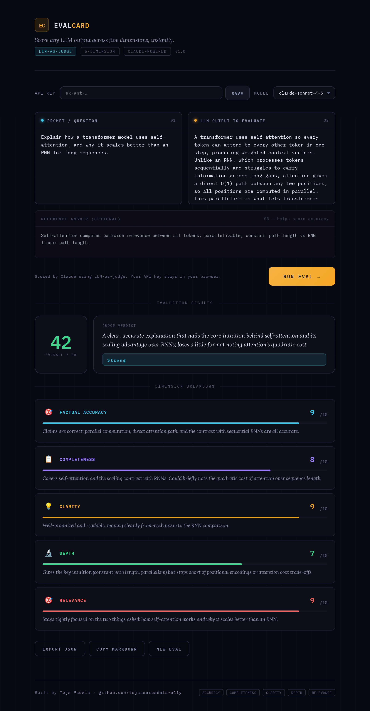

# EVALCARD — LLM & Agent Eval Scorer

**Score any LLM output, a full agent trace, or an A/B comparison in seconds. One HTML file, zero dependencies, and a judge that audits itself.**

EVALCARD v2 is a single-file evaluation tool built around one idea: the hard problem in LLM-as-judge evaluation is not producing scores, it is knowing which scores to distrust. So the judge gets judged. Every comparison runs in both presentation orders to expose position bias, identical passes can be replayed to measure score variance, and every scorecard carries the judge's own stated caveats about where its numbers could mislead.

No backend. No build step. Open the HTML file, add your Anthropic API key, and you are evaluating in under a minute.

---

## Screenshot

*Single Output mode scorecard rendered from `evalcard.html`. Scores and justifications above are a sample for demonstration.*

---

## Live Demo

→ [Open `evalcard.html`](./evalcard.html) directly in your browser. No server or build step.

---

## The Three Modes

### 1. Single Output
The classic scorecard. Paste a prompt and the LLM response to it, optionally add a reference answer, and get a 50-point scorecard across five dimensions with a written justification for each.

| Dimension | What it measures | Max |
|---|---|---|
| **Factual Accuracy** | Are claims correct and verifiable? Penalizes hallucinations. | 10 |
| **Completeness** | Does it address all parts of the prompt? | 10 |
| **Clarity** | Is it well-organized and easy to follow? | 10 |
| **Depth** | Does it go beyond surface-level? Rewards insight and nuance. | 10 |
| **Relevance** | Does it stay focused on what was asked? | 10 |

### 2. Agent Trace
Modern AI systems do not just answer questions, they execute multi-step tasks. Trace mode takes a full agent trajectory (reasoning steps, tool calls with arguments, tool results, final answer) plus the task the agent was given, and scores it on five agent-native dimensions. This is a different rubric, not the text rubric stretched over longer input.

| Dimension | What it measures | Max |
|---|---|---|
| **Goal Completion** | Did the agent accomplish the stated task? Penalizes declared success the trace does not support. | 10 |
| **Tool Selection** | Right tools, sensible arguments. Penalizes wrong-tool calls, missing calls, guessed arguments. | 10 |
| **Step Efficiency** | Direct path. Penalizes redundant calls, loops, and information gathered but never used. | 10 |
| **Error Recovery** | When a step failed, did the agent notice and adapt? With no errors, verification behavior is scored instead, and the judge says so. | 10 |
| **Evidence Faithfulness** | Is the final answer supported by what the trace actually gathered? Penalizes confidence the evidence does not earn. | 10 |

Trace mode also returns **step flags**: specific problematic steps identified by position, each with a one-line issue. A score becomes a debuggable finding.

### 3. A/B Compare, with position bias detection
Two responses to the same prompt, scored head to head with per-dimension deltas and a declared winner. The critical part is the bias check. LLM judges have a documented failure mode: they tend to favor whichever response they read first. EVALCARD therefore runs every comparison **twice, swapping presentation order, with identities masked** as Response 1 and Response 2.

- Same winner in both orders → the card shows an order-stable confirmation.
- Winner flips with order → the card shows a loud position-bias warning, downgrades the verdict to averaged dimension totals, and tells you the result is weak. The flip itself is surfaced as a finding about judge reliability on that input.

Most tools hide this problem. EVALCARD advertises it.

---

## The Trust Layer

- **Two-pass consistency check** (Single and Trace modes): optionally runs the identical judge call twice and displays per-dimension variance. Any dimension shifting by 2+ points between identical passes is flagged as low-confidence. The difference between a score and a score with error bars.
- **Judge self-caveats** (all modes): the judge is required to list specific ways its own scores could mislead you, for example a high clarity score on a confidently wrong answer, or accuracy scored on plausibility because no reference was provided. Caveats can legitimately be empty; a clean result is treated as valid.
- **Session JSONL export**: every eval in a session accumulates as a flat structured record (inputs, scores, judge model, mode, timestamp, consistency data, step flags). One click exports the session as JSONL, the standard format for eval datasets. Every session builds an asset, not just opinions.

---

## Setup

1. Clone or download this repo
2. Open `evalcard.html` in any modern browser (no server required)
3. Enter your [Anthropic API key](https://console.anthropic.com/), stored locally in your browser, never sent anywhere else
4. Pick a judge model or type any Anthropic model ID. The field is free text by design, so the tool does not go stale when new models ship. Default: `claude-sonnet-5-5`.

A/B mode costs 2 API calls per comparison (one per presentation order). The two-pass consistency check doubles the cost of a run. The tool says so before you click.

---

## Export

- **Export JSON** — full result object for the last eval
- **Copy Markdown** — formatted scorecard ready to paste into a doc or Notion
- **Export Session JSONL** — every eval from this session as eval-dataset rows

---

## Architecture

| Component | Detail |
|---|---|
| **Pattern** | LLM-as-judge, with judge-reliability instrumentation |
| **Judge model** | Any Anthropic model ID (free-text field; `claude-sonnet-5-5` default) |
| **API** | Anthropic Messages API (`/v1/messages`), called directly from the browser |
| **Output format** | Structured JSON (parsed from judge response) |
| **Stack** | Single HTML file, vanilla JS, no dependencies |
| **Storage** | API key and model choice in `localStorage` only |

The judge prompts are embedded in the file and fully readable in source, so the methodology is inspectable and the numbers are reproducible by anyone with the file.

---

## Limitations, stated plainly

- Scores reflect the judge model's judgment and inherit its biases. Treat them as directional, not ground truth.
- The two-pass check is a consistency check that catches gross instability. It is not statistics, and the tool does not claim it is.
- Order-swapping **detects** position-dependent inconsistency on a given input. It does not correct an underlying preference.
- LLM judges tend to cluster scores in the 5 to 8 range; treat scores below 5 or above 9 as directionally significant rather than precise.
- Accuracy scoring without a reference answer is inherently limited, and the judge is instructed to say so in its caveats.
- Not a replacement for human evaluation on high-stakes tasks.

## Deferred to v3

- Multi-judge agreement (score with several models, show where they disagree)
- Batch runs from CSV
- Persistent run history

---

## Author

Built by [Teja Padala](https://linkedin.com/in/teja-padala/)
[github.com/tejaswarpadala-a11y](https://github.com/tejaswarpadala-a11y)

---

## License

[MIT](./LICENSE) © 2026 Teja Padala
